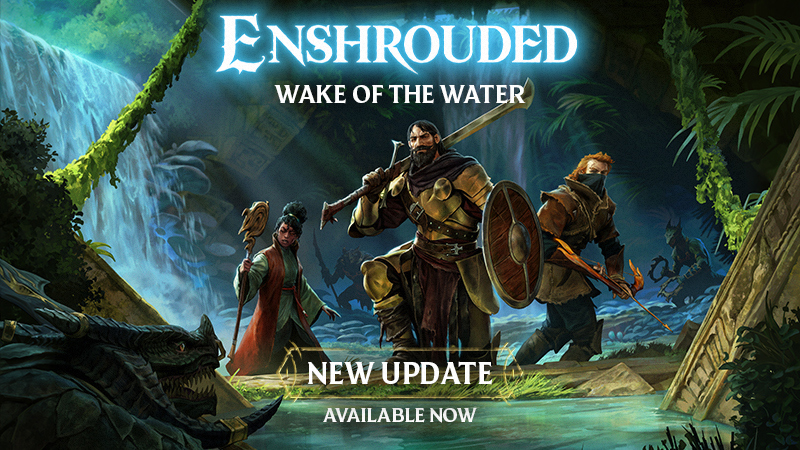

<div align="center">

# 🔧 Setting Up an Enshrouded Dedicated Server on Ubuntu — Guide


[]() []() []()

[](https://syedahmedshere12588.github.io/enshrouded-server-ubuntu-guide/)

</div>

---

This project documents how to set up a dedicated Enshrouded server on Ubuntu, a task that sits at the intersection of Linux administration and running a Windows game binary through Wine. The game itself ships only a Windows server executable, so the guide relies on SteamCMD to fetch the files and Wine to run them, with systemd handling persistence and restarts. It targets Ubuntu 22.04 and 24.04 and assumes readers are comfortable with sudo, port forwarding, and editing configuration files from the command line. Everything here reflects hands-on testing of that specific stack, including the known quirks of Wine updates and the single default game port; it is not a universal recipe for other distributions or container-based deployments.

## Background

Enshrouded is a survival action RPG set in the voxel-based open world of Embervale, where players explore dangerous biomes, gather resources, craft gear, and build bases while contending with hostile creatures and the encroaching Shroud. The game supports cooperative play for groups of up to 16 players, which makes a persistent, always-available world far more practical than relying on a single player's session.

The official dedicated server for Enshrouded is distributed as a Windows executable through Steam. On Ubuntu, this means the server cannot run natively and requires a compatibility layer, specifically Wine, to translate Windows system calls. This guide documents a working approach built around that constraint: installing Wine, fetching the server files with SteamCMD while forcing the Windows platform type, and launching the executable under Wine.

A few practical considerations follow from this setup. SteamCMD should not be run as root, so the guide creates a dedicated unprivileged user to own the server files and process. The server listens on port 15637 by default, which must be reachable from outside your network, and firewall rules such as UFW need to permit it. The server also generates a JSON configuration file on first run, covering the server name, password, player slot count, IP binding, and save and log directories.

Because a game server is expected to stay online, the guide also covers running Enshrouded as a systemd service so it starts on boot and restarts after crashes, along with an optional scheduled restart mechanism intended to mitigate long-run memory growth and resource locking. This project has been tested on Ubuntu 22.04 and 24.04; the steps may work on other Linux distributions, but those configurations are not verified. The goal throughout is a reproducible, reasonably hardened setup that a beginner can follow without prior experience running Wine-based game servers.

## Key Points

- **Windows binary via Wine:** The Enshrouded dedicated server ships as a Windows executable, so Ubuntu hosts run it through Wine rather than a native Linux build. Expect to install Wine staging plus supporting packages (cabextract, winbind, screen, xvfb) before the server will launch.

- **SteamCMD with a forced platform type:** The server files are fetched anonymously through SteamCMD, but the platform type must be explicitly forced to Windows. This is the detail most guides miss, and skipping it results in an incomplete or incorrect download.

- **Dedicated non-root user:** SteamCMD refuses to run as root, so the guide creates a separate service account to own the server directory and process. Running under a dedicated user also limits the blast radius if the server is compromised.

- **JSON-based configuration:** On first launch the server generates a configuration file covering server name, password, player slots, bind IP, save directory, and log directory. The bind IP matters — leaving it misconfigured is a common reason the server appears online but is unreachable.

- **Port and firewall requirements:** The server listens on a single default port, which must be opened in the firewall and forwarded at the router for external access. Internal testing can succeed while remote players still cannot connect if this step is skipped.

- **Systemd service for persistence:** A unit file lets the server start at boot, restart automatically after crashes, and optionally re-run the SteamCMD update step before each start. This is the difference between a one-off experiment and a server you can leave running.

- **Scheduled restarts (experimental):** An optional restart routine is included to clear memory leaks and stale processes during off-hours. The project labels this as experimental, and it should be treated as a convenience rather than a guaranteed fix for stability problems.

- **Version drift is a real risk:** Because the server depends on Wine, SteamCMD, and the game's own updates, a working setup can break after an upstream change. The guide favors current Ubuntu LTS releases but is honest that long-term stability depends on keeping Wine and the server files updated.

- **Scope and limitations:** This is a beginner-oriented, single-host setup for a small cooperative group — not a clustered or high-availability deployment. It assumes basic familiarity with the Linux shell, sudo, and editing text files over SSH.

## Examples

The examples below show how the pieces described in this guide fit together on a working Ubuntu host. Each scenario lists what to run, what you should see, and what to check when it does not behave as expected.

### Example 1: First boot and verifying the server came online

After the server files are installed and the executable is launched under Wine, a healthy startup produces two log lines in sequence: a host-online confirmation followed by a session transition from lobby to host-online state. If you see both lines, the process is listening and accepting connections.

```
[Session] 'HostOnline' (up)!
[Session] finished transition from 'Lobby' to 'Host_Online' (current='Host_Online')!
```

Common variations and what they mean:

- **Only the first line appears, then the process exits.** The servermost likely failed to bind to the configured IP. Check that `ip` in the configuration file matches an address actually present on the host, or set it to `0.0.0.0` for all interfaces.
- **No output at all before exit.** Confirm that Wine is fully initialized for the service user. Running the executable manually once as that user will populate the Wine prefix and surface any missing dependency messages.
- **Output stops at a font or display warning.** These warnings are generally harmless under a headless setup; the session lines appearing afterward is what matters.

### Example 2: Editing the configuration before first launch

The server writes `enshrouded_server.json` into its install directory on first run. A minimal configuration that a small group can use looks like this:

```json
{
 "name": "Embervale Friends",
 "ip": "0.0.0.0",
 "gamePort": 15637,
 "queryPort": 15638,
 "slotCount": 8,
 "password": "choose-something-strong"
}
```

Practical notes drawn from real setups:

- Change `name`, `password`, and `slotCount` first; these are the settings players notice immediately.
- `ip` is the most common source of confusion. Leaving it at the default may bind the server to an address that is not reachable from outside the machine. Set it to `0.0.0.0` unless you have a specific reason to pin a single interface.
- Keep a copy of the file before editing. A trailing comma or a value of the wrong type will stop the server from starting, and the log message does not always point at the exact line.
- The exact field names and accepted ranges are documented in the project's own server settings reference; consult it before adding keys that are not shown above.

### Example 3: Choosing between manual launch and a service

Running the executable by hand is useful while you are validating configuration, because errors print directly to the terminal and you can stop the process with a keystroke. Once the server behaves correctly, moving it to a systemd unit is the recommended end state.

The difference in practice:

- **Manual launch:** fast feedback, but the server stops when your SSH session ends unless you use a terminal multiplexer or run it under a virtual display.
- **Service launch:** the server starts at boot, restarts after a crash, and keeps running after you disconnect. Configuration errors, however, become less visible; you have to check the journal instead of the terminal.

A typical journal check after enabling the unit looks like a stream of Wine and session messages ending in the host-online lines. If the unit enters a restart loop, read the last few dozen lines of the journal rather than the full output, since the restart repeats the same failure each time.

### Example 4: Confirming the server is reachable from outside

On the host, confirm the process is listening on the expected port. From a second machine on the same network, attempt a connection using the game client's direct-connect option with the host's LAN address.

If the LAN connection works but a connection over the internet does not, the cause is almost always one of:

1. The port is not forwarded on the router to the Ubuntu host.
2. A local firewall is dropping the traffic. On UFW, the port must be allowed explicitly, and rules are not applied to forwarded traffic unless forwarding is enabled.
3. The client is using the wrong address — the public address of the network, not the host's private one.

Verifying each of these in order quickly narrows the problem down, and it is worth testing from outside your own network rather than assuming a successful LAN test implies external reachability.

### Example 5: Updating the server without losing saves

The server files are refreshed by re-running the SteamCMD update step against the existing install directory; the save directory is separate and is not touched by the update. In practice:

- Stop the service (or the manual process) before updating so the executable is not in use.
- Re-run the update step with the same install directory used originally.
- Start the server again and confirm the host-online lines appear.
- Back up the save directory before any update you are unsure about. Updates have occasionally changed configuration expectations, and a restore is far cheaper than a corrupted world.

### Example 6: Scheduled restarts as a maintenance measure

Long-running dedicated servers accumulate memory pressure and occasional stuck resources. A nightly restart clears both. The project ships an experimental scheduled-restart helper for this purpose, and the honest caveat is that it is a convenience script, not a guarantee: it reduces the symptoms of long uptime but does not fix underlying leaks.

If you adopt it, stagger the restart time away from your group's usual play hours, and verify after the first few runs that players reconnect cleanly and the world state is intact. Treat the first week as a trial period rather than assuming it works unattended.

## 📸 Screenshot




## References

The contents of this guide are assembled from hands-on testing performed against a live Ubuntu installation and reflect the behavior of the Enshrouded dedicated server as observed at the time of writing. Where the guide touches on Wine, SteamCMD, systemd, or save-file handling, the described steps were verified end to end rather than transcribed from secondary summaries.

That said, the guide is a snapshot, not a contract. Enshrouded continues to receive content and server-side updates, and the dedicated server binary, its configuration schema, and the JSON settings it accepts can change between releases. Valve's SteamCMD tooling and the Wine project also evolve independently, so a command that worked cleanly on a given Ubuntu point release may require a small adjustment later. When the guide and the live system disagree, trust the live system.

The project's own files are the authoritative reference for this repository. The configuration settings are documented in the accompanying settings reference under the project's documentation folder, and the optional scheduled-restart helper lives in its own resource directory. Both are maintained alongside the guide and should be treated as the source of truth for option names, defaults, and script behavior. The systemd unit definition, the `enshrouded` service account convention, and the directory layout used throughout this guide are all internal to this project and are not externally mandated.

A few honest caveats are worth stating plainly. The scheduled-restart approach is explicitly experimental, as noted in its own section; it may help clear accumulated memory or release locked resources, but no guarantee is offered that it will resolve any particular stability problem. Some troubleshooting steps in this guide address symptoms rather than root causes, and a future server update may render a given workaround unnecessary or ineffective. Corrections and improvements are welcome through the project's issue tracker, and readers who encounter behavior that diverges from what is described here are encouraged to report it so the guide can be kept accurate.

Finally, this guide is not affiliated with or endorsed by the developers or publishers of Enshrouded, nor by the maintainers of Ubuntu, Wine, or SteamCMD. Product names and trademarks belong to their respective owners and are used here only to describe the software being configured.

## Conclusion

At this point, the server is running, configured, and registered as a systemd service, which covers the essential steps for a stable, restart-resilient Enshrouded host. Keep in mind that Wine remains a compatibility layer rather than a native runtime, so the setup can carry a modest performance overhead compared to a native Linux binary, and future game updates may occasionally require adjustments to the Wine version or launch command. It is worth pinning or monitoring the Wine staging release you tested against, since auto-updates have already been observed to change which executable name works. The scheduled restart routine is explicitly experimental and should be validated against your own player activity before relying on it, and backing up the save directory before major updates is a sensible precaution. Finally, treat this guide as a maintenance reference rather than a one-time setup: the configuration file, the service unit, and the SteamCMD update line are the three places to revisit when the game or server tooling changes. With those caveats in mind, the resulting setup should provide a dependable foundation for long-running cooperative sessions.

[](https://syedahmedshere12588.github.io/enshrouded-server-ubuntu-guide/)